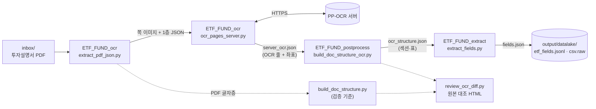

# ETF_FUND_pipeline

ETF 투자설명서 PDF를 OCR로 읽고, 문서 구조(섹션·표)로 재구성한 뒤, 동종 ETF 비교(스노우플레이크)에 쓸 값만 뽑아 데이터레이크 파일로 저장하는 파이프라인입니다.

PDF 글자층은 깨지거나 표가 무너지는 경우가 많아서 **OCR 결과를 본 경로**로 씁니다. PDF 글자층으로 만든 구조는 OCR 결과가 맞는지 재는 검증 기준으로만 씁니다.

## 구성

| 폴더 | 단계 | 하는 일 |
|---|---|---|
| `ETF_FUND_ocr/` | 1. OCR | PDF 쪽 이미지 렌더링과 1층 JSON(`extract_pdf_json.py`), 원격 PP-OCR 서버 호출(`ocr_pages_server.py`) |
| `ETF_FUND_postprocess/` | 2. OCR 후처리 | OCR 줄을 섹션·표·병합 칸·쪽을 넘는 표로 재구성(`build_doc_structure_ocr.py`), 공통 규칙과 검증용 PDF 기준 구조(`build_doc_structure.py`), HTML 보기(`render_structure.py`), 원본 대조 검토(`review_ocr_diff.py`) |
| `ETF_FUND_extract/` | 3. 스노우플레이크용 추출 | 후처리 결과에서 비용·성과·안정·규모·유형 값만 뽑아 데이터레이크 파일 생성(`extract_fields.py`) |
| `run_pipeline.py` | 전체 실행 | 세 단계를 차례로 실행. 결과가 입력보다 새로우면 그 단계는 건너뜀 |
| `samples/` | 샘플 | KODEX200 투자설명서 1건 (원본, OCR 결과, 후처리 결과, 추출 결과) |

## 데이터 흐름



문서 하나의 결과는 `output/<문서명>/`에 모입니다.

| 파일 | 만드는 단계 | 내용 |
|---|---|---|
| `<문서명>.json`, `<문서명>_images/` | 1 | 1층 JSON(쪽 크기, PDF 글자층), 쪽 이미지 |
| `<문서명>.server_ocr.json` | 1 | OCR 줄과 좌표 |
| `<문서명>.ocr_structure.json` / `.html` | 2 | OCR 기반 섹션·표 구조 (본 결과) |
| `<문서명>.structure.json` / `.html` | 2 | PDF 글자층 기준 구조 (검증용) |
| `<문서명>.ocr_review.html` | 2 | 원본 쪽 이미지 위에서 OCR 결과와 기준을 대조 |
| `<문서명>.fields.json` | 3 | 추출 값 (값마다 쪽·표 ID·원래 글자 포함) |

전체 문서를 모은 데이터레이크는 `output/datalake/`에 있습니다.

| 파일 | 내용 |
|---|---|
| `etf_fields.jsonl` | 문서당 한 줄 JSON |
| `etf_fields.csv.raw` | 엑셀용 평면 표 (UTF-8 BOM). 값과 쪽 번호만 담음 |
| `etf_fields_columns.csv.raw` | 컬럼 사전 (컬럼, 설명, 단위) |
| `coverage.md` | 항목 × 문서별 추출 현황 |

> CSV와 PDF는 회사 문서 보안 프로그램이 저장 시 암호화하므로 `.raw`를 붙여 저장합니다. 내용은 일반 CSV, PDF와 같습니다.

## 사용법

### 준비

Python 3.12 이상.

```bash
pip install -r requirements.txt
```

OCR 서버 접속 정보는 환경 변수로 넣습니다. 코드에는 들어 있지 않습니다.

| 변수 | 설명 |
|---|---|
| `OCR_SERVER` | PP-OCR 서버 주소 (예: `https://<host>/ppocr`) |
| `OCR_API_KEY` | `X-API-Key` 헤더 값 |
| `OCR_BASIC_AUTH` | 터널 앞단 Basic 인증 `사용자:비밀번호` (없으면 생략) |

Windows에서는 현재 셸에 없는 값을 사용자 환경 변수(`HKCU\Environment`)에서도 읽습니다.

### 실행

```bash
# inbox/ 의 .pdf, .pdf.raw 전부 처리
python run_pipeline.py

# 특정 파일·폴더만
python run_pipeline.py inbox/KODEX200_투자설명서.pdf.raw

# 코드를 고친 뒤 모든 단계 다시 실행
python run_pipeline.py --force

# 저장된 OCR 결과(<문서명>.server_ocr.json) 재사용, 서버 호출 없음
python run_pipeline.py --skip-ocr
```

단계별로 따로 실행할 수도 있습니다.

```bash
python ETF_FUND_ocr/extract_pdf_json.py 원본.pdf -o output/X/X.json --images-dir output/X/X_images
python ETF_FUND_ocr/ocr_pages_server.py 원본.pdf output/X/X.json -o output/X/X.server_ocr.json
python ETF_FUND_postprocess/build_doc_structure_ocr.py output/X/X.json output/X/X.server_ocr.json -o output/X/X.ocr_structure.json
python ETF_FUND_extract/extract_fields.py output/X/X.ocr_structure.json   # 한 문서
python ETF_FUND_extract/extract_fields.py --all                           # 전체 + 데이터레이크
```

### 샘플로 돌려 보기 (OCR 서버 없이)

```bash
cp samples/KODEX200_투자설명서/KODEX200_투자설명서.pdf.raw inbox/
mkdir -p output/KODEX200_투자설명서
cp samples/KODEX200_투자설명서/KODEX200_투자설명서.server_ocr.json output/KODEX200_투자설명서/
python run_pipeline.py --skip-ocr
```

약 2분 뒤 `output/KODEX200_투자설명서/KODEX200_투자설명서.fields.json`이 `samples/`의 같은 파일과 똑같이 나옵니다.

### 테스트

```bash
python ETF_FUND_extract/tests/test_extract_fields.py
```

## 추출 항목

모든 값은 문서에 공시된 최근 기준 값입니다. 문서끼리 기준일은 맞추지 않습니다.

| 축 | 항목 | 키 | 단위 |
|---|---|---|---|
| 안정 | 투자위험등급 (1=매우 높음 ~ 6=매우 낮음) | `risk_grade` | 등급 |
| 안정 | 수익률 변동성 (연환산 표준편차) | `volatility.{1y,2y,3y,5y,since_inception}` | % |
| 성과 | 연평균 수익률 | `returns.*` | % |
| 성과 | 비교지수 연평균 수익률 | `benchmark_returns.*` | % |
| 성과 | 연도별 수익률 (펀드, 비교지수) | `annual_returns[]` | % |
| 비용 | 운용·지정참가·신탁·사무관리 보수, 총보수 | `fees.{management,ap,trustee,admin,total}` | 연 % |
| 비용 | 기타비용, 총보수·비용, 합성총보수·비용 | `fees.{other_expenses,ter,synthetic_ter}` | 연 % |
| 비용 | 동종유형 총보수 (같은 유형 펀드 평균) | `fees.peer_total` | 연 % |
| 비용 | 매매·중개수수료율 | `trading_cost` | 연 % |
| 규모 | 순자산, 최근 3기 | `net_assets[].{period,amount}` | 원 |
| 유형 분류 | 기초지수, 펀드 유형, 레버리지 배율, 환헤지 | `classification.*` | |
| 참고 | 최초 설정일, 상장일, 작성 기준일 | `dates.*` | 날짜 |

투자설명서에 없어서 따로 받아야 하는 데이터(일별 순자산, 거래대금, 구성종목 등)는 [docs/external-data-needs.md](docs/external-data-needs.md)에 정리했습니다.

## 추출 예시 (KODEX200)

`samples/KODEX200_투자설명서/KODEX200_투자설명서.fields.json`에서 발췌했습니다.

| 항목 | 값 |
|---|---|
| 펀드명 | 삼성KODEX200증권상장지수투자신탁[주식] |
| 운용사 | 삼성자산운용주식회사 |
| 투자위험등급 | 2 |
| 수익률 1년 / 3년 / 5년 (%) | 142.89 / 50.59 / 24.16 |
| 비교지수 1년 / 3년 / 5년 (%) | 140.14 / 47.76 / 21.67 |
| 변동성 1년 / 3년 / 5년 (%) | 41.94 / 28.82 / 24.46 |
| 수익률 기준일 | 2026-09-11 |
| 총보수 / 기타비용 / 총보수·비용 (연 %) | 0.15 / 0.0115 / 0.1615 |
| 매매·중개수수료율 (연 %) | 0.0283 |
| 순자산 2025-12-31 / 2024-12-31 / 2023-12-31 (원) | 11,696,824,758,499 / 5,491,231,070,594 / 6,561,194,072,870 |
| 연도별 수익률 2026 / 2025 / 2024 (펀드 %, 비교지수 %) | 142.89·140.14 / 38.57·35.26 / 1.57·-0.57 |
| 최초 설정일 | 2002-10-11 |

`fields.json`에는 값마다 출처가 함께 들어 있어 원본과 대조할 수 있습니다.

```json
"ter": { "value": 0.1615, "page": 35, "node": "t41", "raw": "0.1615" }
```

## 알려진 한계

- OCR 오인식이 문자 값에 남을 수 있습니다 (예: 기초지수 `K0SP1200`). 숫자 칸의 `O`→`0` 같은 오인식은 보정합니다.
- 원본 문서 자체의 오기는 그대로 추출됩니다 (예: 변동성 칸에 수익률을 반복해 적은 문서).
- 환헤지, 상장일, 동종유형 총보수는 문서에 명시되지 않은 경우가 많아 비어 있을 수 있습니다.
- 펀드코드, 편입한도는 현재 추출하지 않습니다.
